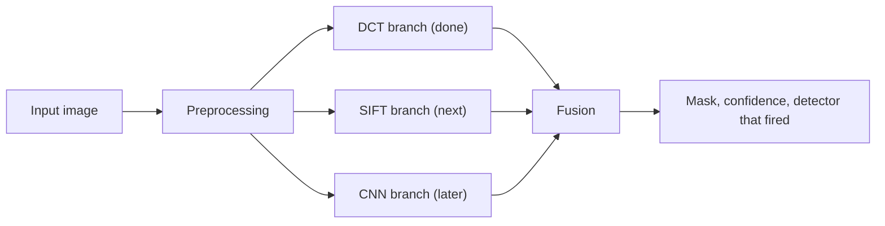
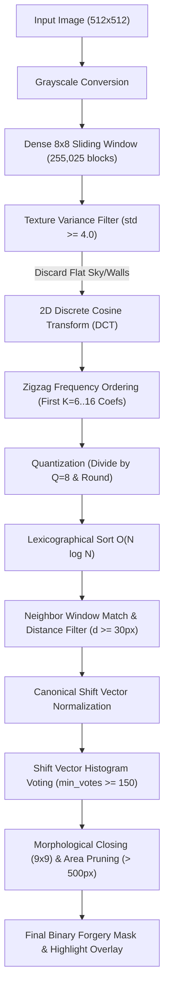

# Doppel: Scientific Image Integrity

**See the copy. Reveal the manipulation.**

[](https://www.python.org/)
[](https://opencv.org/)
[](https://scipy.org/)
[](https://flask.palletsprojects.com/)
[](http://vcl.fer.hr/comofod/)

Doppel is a research prototype that finds copy-move forgery (a region copied and pasted inside the same image) in scientific images such as western blots and microscopy photos. It is built for a Digital Image Processing (DIP) course project and is being developed in stages as a hybrid of three detectors: **DCT** (finished), **SIFT** (next) and a **CNN** (later).

Doppel is inspired by commercial image integrity tools but it is a small prototype, not a replacement for them.

---

## Status

| Phase | Work | Status |
| :--- | :--- | :--- |
| 1 | DCT baseline and dashboard | Done |
| 2 | SIFT detection, matching, RANSAC check, mirrored pass | Done |
| 3 | Synthetic forgery generator and benchmark | Next |
| 4 | CNN branch (pretrained features, self-correlation) | Planned |
| 5 | Fusion and ablation study | Planned |
| 6 | Scientific image evaluation and basic report | Planned |
| 7 | Product wrapper (API, queue, new frontend), optional | Planned |

Everything under "DCT Baseline", "Benchmark Results", and "SIFT Branch" below is finished and measured. The git tag `dct-baseline` marks the frozen DCT baseline, and `sift-baseline` marks the frozen SIFT branch.

---

## Table of Contents
- [Overview](#overview)
- [Why a Hybrid](#why-a-hybrid)
- [DCT Baseline: System Architecture](#dct-baseline-system-architecture)
- [How the DCT Detector Works](#how-the-dct-detector-works)
- [Benchmark Results (CoMoFoD)](#benchmark-results-comofod)
- [Limitations](#limitations)
- [Web Interface (Baseline Demo)](#web-interface-baseline-demo)
- [Project Structure](#project-structure)
- [Installation and Setup](#installation-and-setup)
- [Usage](#usage)
- [DCT vs Keypoint Methods](#dct-vs-keypoint-methods)
- [References](#references)

---

## Overview

**Copy-move forgery** occurs when part of an image is copied and pasted into another location in the same image, to hide something or to duplicate an object. Because the pasted region comes from the same image, it shares the same noise pattern, dynamic range and color balance, so looking at the image by eye often fails.

### What the DCT baseline does (measured)
* Processes 255,025 overlapping 8x8 blocks of a 512x512 image in about 0.35 seconds in our runs, using vectorized NumPy and an $O(N \log N)$ sort.
* Detects 90.0% (36 / 40) of translation forgeries on CoMoFoD, with an average F1 of 0.817.
* Gives 0 / 40 false alarms on the original CoMoFoD images with the texture filter on (17 / 40 without it).
* Fails on rotation, scaling and distortion (see [Limitations](#limitations)). This gap is the reason for the hybrid.
* Comes with a Flask dashboard for trying images and tuning parameters.

---

## Why a Hybrid

Each detector is strong where the others are weak:

- **DCT (block-based):** dense and precise, works on flat areas, but breaks when the copy is rotated or scaled.
- **SIFT (keypoints):** finds the same local pattern even when rotated or scaled, but needs textured regions and needs an extra pass for mirrored copies.
- **CNN (learned features):** compares deep features of every region with every other region, which can handle harder changes, but needs training data.

Planned pipeline (not built yet):



Rule for this project: a phase does not start until the previous one has written results, and nothing is claimed that was not measured.

---

## DCT Baseline: System Architecture



---

## How the DCT Detector Works

### 1. Dense Block Extraction
Instead of non-overlapping grids, the detector slides an $8 \times 8$ window across every pixel coordinate using `numpy.lib.stride_tricks.sliding_window_view`. For a $512 \times 512$ image:
$$\text{Total Blocks} = (512 - 8 + 1) \times (512 - 8 + 1) = 255,025 \text{ blocks}$$
This dense sampling ensures copied patches placed at arbitrary pixel alignments are captured.

### 2. Texture Variance Filtering
Large uniform regions (clear skies, blank walls, calm water) contain nearly identical pixel values. Without filtering, tens of thousands of such blocks produce identical fingerprints and cause massive false positives.
Every block is evaluated by its local standard deviation:
$$\sigma_{\text{block}} = \sqrt{\frac{1}{64}\sum_{i=1}^{64} (x_i - \mu)^2} \ge \sigma_{\text{min}} \quad (\text{default } 4.0)$$
Blocks with $\sigma < 4.0$ are pruned before matching. On the 40 original CoMoFoD images this lowered false alarms from 42.5% (17 / 40) to 0% (0 / 40).

### 3. 2D DCT and Zigzag Ordering
Each surviving block is transformed into the frequency domain with SciPy's orthogonal `dctn`:
- Top-left $(0, 0)$ is the **DC component** (average brightness).
- Coefficients farther from $(0, 0)$ are higher spatial frequencies.

Natural image energy is concentrated in the low frequencies. Coefficients are read in a **zigzag path** and the first $K$ ($K=6$ to $16$) are kept as a compact feature descriptor.

```
Zigzag Indexing (8x8):
 0   1   5   6  14  15  27  28
 2   4   7  13  16  26  29  42
 3   8  12  17  25  30  41  43
 9  11  18  24  31  40  44  53
...
```

### 4. Quantization
To tolerate noise and lossy JPEG re-compression, descriptors are discretized:
$$\vec{f}_{\text{quantized}} = \left\lfloor \frac{\vec{f}}{Q} + 0.5 \right\rfloor \quad (\text{default } Q=8)$$

### 5. Lexicographical Sorting and Matching
Comparing all $255,000$ blocks pairwise would need about $6.5 \times 10^{10}$ comparisons ($O(N^2)$). Instead, feature rows are sorted with `numpy.lexsort`:
- Identical or near-identical fingerprints end up next to each other ($O(N \log N)$).
- A sliding search window ($k = 1 \dots 5$) checks the immediate neighbors.
- Candidate pairs closer than `min_dist` ($30\text{px}$) are discarded, so neighboring blocks of the same smooth object are not matched.

### 6. Shift Vector Histogram Voting
For every matching block pair $(A, B)$, the displacement vector is:
$$\vec{s} = (y_B - y_A, \; x_B - x_A)$$
Vectors are flipped to a canonical down/right direction to remove the $A \to B$ vs $B \to A$ ambiguity. Votes are counted:
- If a patch was translated by $(\Delta y, \Delta x)$, all its blocks vote for the same vector.
- Only vectors with at least `min_votes` ($150$) votes are kept.

### 7. Morphological Cleanup
Surviving blocks are painted on a blank mask and cleaned up:
- **Morphological closing ($9 \times 9$ kernel):** fills holes and gaps.
- **Small object removal (`skimage.morphology.remove_small_objects`):** drops clusters smaller than $500\text{px}$.

---

## Benchmark Results (CoMoFoD)

Evaluated on the CoMoFoD small category ($512 \times 512$), 40 image sets per manipulation type, 200 sets in total.

### Performance by Manipulation Category

| Category | Image Sets | Manipulation | Detection Rate | Avg F1 |
| :--- | :--- | :--- | :--- | :--- |
| **Translation** | `001` to `040` | Rigid displacement $(\Delta y, \Delta x)$ | **90.0% (36 / 40)** | **0.817** |
| **Rotation** | `041` to `080` | Copied and rotated ($1^\circ \dots 180^\circ$) | 12.5% (5 / 40) | 0.082 |
| **Scaling** | `081` to `120` | Copied and scaled ($0.5\times \dots 2.0\times$) | 2.5% (1 / 40) | 0.021 |
| **Distortion** | `121` to `160` | Deformed and sheared | 20.0% (8 / 40) | 0.145 |
| **Combination** | `161` to `200` | Rotation and scaling together | 2.5% (1 / 40) | 0.018 |

### False Alarms on Original Images

| Dataset | Tested | False Alarms (no texture filter) | False Alarms (with texture filter) |
| :--- | :--- | :--- | :--- |
| CoMoFoD originals (`_O.png`) | 40 images | 17 / 40 (42.5%) | 0 / 40 (0.0%) |

---

## Limitations

- **No rotation or scale invariance.** Block matching assumes the copy looks the same as the source, so rotated, scaled, sheared and combined forgeries are mostly missed (see the table above). Mirrored copies are also not handled.
- **The texture filter may remove useful regions.** Low-texture areas are discarded on purpose. This has not been tested on scientific images (blot or microscopy backgrounds), where it may need retuning.
- **Only CoMoFoD small images so far.** There is no evaluation on scientific figures yet, and no synthetic benchmark yet (Phase 3).
- **Detects copy-move only.** Splicing, deletion and AI-generated images are out of scope.
- **It flags suspicious regions, it does not give a verdict.** Repeated patterns can be innocent, so a human has to review the result.

---

## Web Interface (Baseline Demo)

A Flask dashboard for the DCT baseline, with a dark UI and Lenis smooth scrolling. It is kept as the working baseline demo and is not replaced by later phases.

### Features
* **Drag and drop:** upload JPG, PNG, BMP or TIFF images.
* **CoMoFoD browser:** load images grouped by category (Translation, Rotation, Scaling, Distortion, Combination).
* **Views:**
  * **Overlay:** red semi-transparent fill and contour around the detected region.
  * **Binary mask:** black and white mask, comparable with ground truth.
  * **Original:** the uploaded input.
* **Live stats:** flagged pixel count, percent of image flagged, run time in milliseconds, number of regions.
* **Dominant shift table:** top displacement vectors $(\Delta y, \Delta x)$ with vote counts.
* **Mask download:** export the binary mask as PNG.

---

## Project Structure

```
doppel/
├── data/                       # local only, not in git
│   ├── synthetic/              # synthetic test images and ground truth
│   └── comofod/                # CoMoFoD benchmark
│       ├── translation/        # sets 001 to 040
│       ├── rotation/           # sets 041 to 080
│       ├── scaling/            # sets 081 to 120
│       ├── distortion/         # sets 121 to 160
│       ├── combination/        # sets 161 to 200
│       ├── readme.txt
│       └── psnr.txt
├── detector/                   # core Python package
│   ├── detect.py               # end-to-end DCT pipeline
│   ├── features.py             # sliding window, DCT, zigzag, variance filter
│   ├── matching.py             # lexsort matching, distance threshold, voting
│   ├── evaluate.py             # precision, recall, F1
│   └── sift/                   # SIFT detection package
│       ├── features.py         # keypoints, 128-d descriptors
│       ├── matching.py         # within-image, flip pass, orientation filter
│       ├── verification.py     # spatial clustering, RANSAC affine verification
│       └── localization.py     # per-cluster convex hull, detect_sift pipeline
├── web/                        # Flask baseline demo (keep as is)
│   ├── app.py
│   ├── templates/index.html
│   └── static/                 # style.css, app.js, lenis.min.js, lenis.css
├── scripts/                    # evaluation and test runners
│   ├── batch_test.py           # evaluation over benchmark images (DCT)
│   ├── batch_test_sift.py      # evaluation over benchmark images (SIFT)
│   ├── ablate_sift.py          # tuning and held-out calibration runner
│   ├── false_alarm_test.py     # false alarms on originals
│   ├── experiments.py          # noise, blur and JPEG tests
│   ├── make_test.py            # synthetic copy-move test images
│   └── try_001.py              # single-image test
├── figures/
│   └── robustness.png
├── learning/
│   └── dct_demo.py             # DCT basis demonstration
├── results/                    # benchmark CSVs and evaluation summaries
│   └── phase2_sift/            # SIFT benchmark, ablation, failure analysis
├── tests/
│   └── test_flip.py            # coordinate mapping and reflection tests
├── agentlogs/                  # living project documentation
├── pyproject.toml
├── DOPPEL_AGENT.md             # working plan and rules for the coding agent
└── README.md
```

Planned additions: `detector/synthetic.py` (Phase 3), CNN and fusion modules (Phases 4-5), and a separate `frontend/` for the Phase 7 dashboard.

---

## Installation and Setup

### Prerequisites
- **Python 3.11+**
- Recommended: [`uv`](https://github.com/astral-sh/uv), or standard `pip`

### 1. Clone the Repository
```bash
git clone https://github.com/iamabd55/doppel.git
cd doppel
```

### 2. Install Dependencies
With `uv`:
```bash
uv sync
```

Or with `pip`:
```bash
pip install flask matplotlib numpy opencv-python scikit-image scikit-learn scipy
```

### 3. Get the Dataset
Download CoMoFoD from http://www.vcl.fer.hr/comofod and place the sets in `data/comofod/` using the folder layout above. The dataset is not included in this repository.

---

## Usage

### 1. Launch the Web App
```bash
uv run python web/app.py
```
Open **http://localhost:5000** in your browser.

### 2. Run Batch Benchmarks
```bash
uv run scripts/batch_test.py
```

### 3. Run the False Alarm Check
```bash
uv run scripts/false_alarm_test.py
```

### 4. Run Robustness Experiments
Noise, blur and JPEG quality tests:
```bash
uv run scripts/experiments.py
```
Output is saved to `figures/robustness.png`.

---

## DCT vs Keypoint Methods

Measured comparison between the frozen DCT baseline and the calibrated SIFT branch (`cfg8_best_combo`) on the CoMoFoD benchmark. Both columns reflect measured results from this repository (see `results/phase2_sift/ablation_held_out_split.md` and `results/phase2_sift/failure_analysis.md`).

| Dimension | Block-DCT (Phase 1, measured) | SIFT Branch (Phase 2, measured) |
| :--- | :--- | :--- |
| Sampling | Dense (255,025 overlapping blocks per 512x512 image) | Sparse (DoG keypoints at scale-space extrema) |
| Translation (Held-Out) | 90.0% detection (36/40, F1 0.817) | 70.0% detection (14/20, F1 0.479) |
| Rotation (Held-Out) | 12.5% detection (5/40, F1 0.082) | 70.0% detection (14/20, F1 0.521) |
| Scaling (Held-Out) | 2.5% detection (1/40, F1 0.021) | 75.0% detection (15/20, F1 0.543) |
| Distortion (Held-Out) | 20.0% detection (8/40, F1 0.145) | 80.0% detection (16/20, F1 0.637) |
| Combination (Held-Out) | 2.5% detection (1/40, F1 0.018) | 75.0% detection (15/20, F1 0.520) |
| Overall Detection | 25.5% (51/200) across all forged sets | 74.0% (74/100) on held-out forged sets |
| Clean False Alarms | 0/40 (0.0% pixel FAR with texture filter) | 8/20 (40.0% image rate, 1.76% pixel FAR) |
| Smooth / Flat Regions | Detects uniform copies when texture filter permits | Zero keypoints on featureless patches (sets 055-058) |
| Mirrored Copies | Not handled | Handled via horizontal flip pass |
| Output | Dense painted block mask | Matched point pairs, per-cluster convex hull mask |

The measured results confirm the hybrid rationale: DCT provides reliable translation detection and zero false alarms on clean images, while SIFT covers geometric rotation, scaling, and reflection where DCT collapses. Phase 3 (synthetic benchmark) and Phase 4 (CNN branch) prepare the ground for hybrid fusion in Phase 5 to suppress remaining false alarms.

---

## References

1. Fridrich, J., Soukal, D., & Lukas, J. (2003). Detection of copy-move forgery in digital images. *Proceedings of DFRWS*, 134-137.
2. Tralic, D., Zupancic, I., Grgic, S., & Grgic, M. (2013). CoMoFoD: new database for copy-move forgery detection. *Proceedings of ELMAR-2013*, 49-54.
3. Lowe, D. G. (2004). Distinctive image features from scale-invariant keypoints. *International Journal of Computer Vision*, 60(2), 91-110.
4. Amerini, I., Ballan, L., Caldelli, R., Del Bimbo, A., & Serra, G. (2011). A SIFT-based forensic method for copy-move attack detection and transformation recovery. *IEEE Transactions on Information Forensics and Security*, 6(3), 1099-1110.
5. Christlein, V., Riess, C., Jordan, J., Riess, C., & Angelopoulou, E. (2012). An evaluation of popular copy-move forgery detection approaches. *IEEE Transactions on Information Forensics and Security*, 7(6), 1841-1854.
6. Wu, Y., Abd-Almageed, W., & Natarajan, P. (2018). BusterNet: detecting copy-move image forgery with source/target localization. *ECCV 2018*, LNCS 11210, 170-186.
7. Islam, A., Long, C., Basharat, A., & Hoogs, A. (2020). DOA-GAN: dual-order attentive generative adversarial network for image copy-move forgery detection and localization. *CVPR 2020*, 4676-4685.
8. Bik, E. M., Casadevall, A., & Fang, F. C. (2016). The prevalence of inappropriate image duplication in biomedical research publications. *mBio*, 7(3), e00809-16.

---

## License

This project was developed for academic research and educational purposes in Digital Image Processing (DIP). Feel free to use and adapt it with attribution.